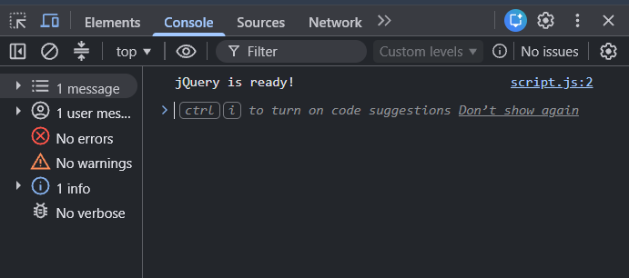
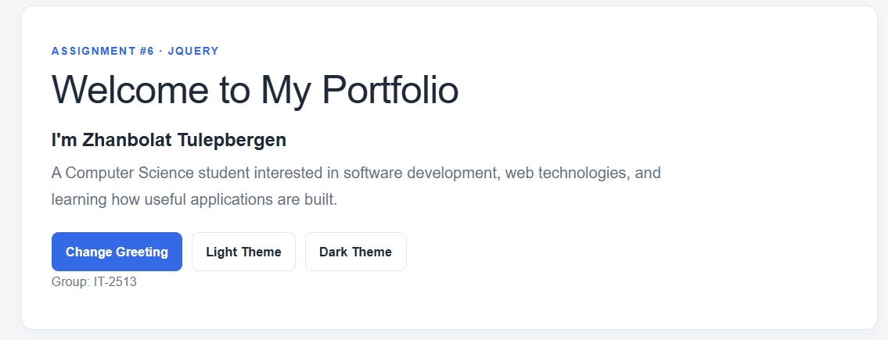
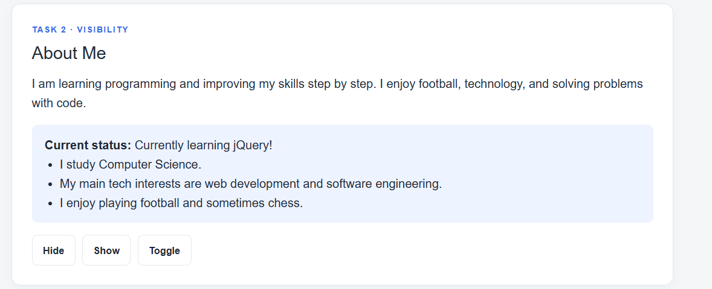
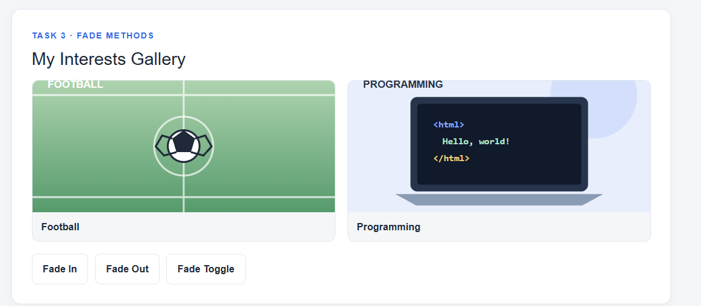
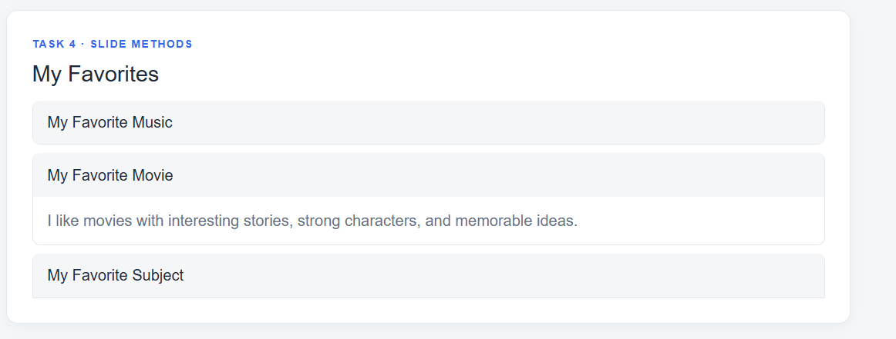
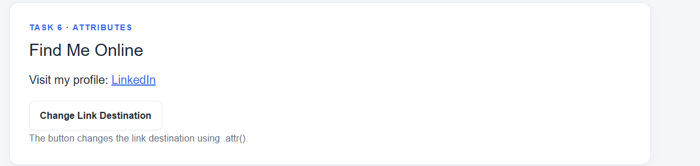
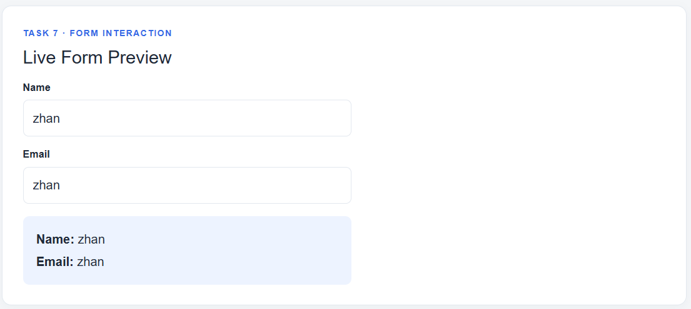
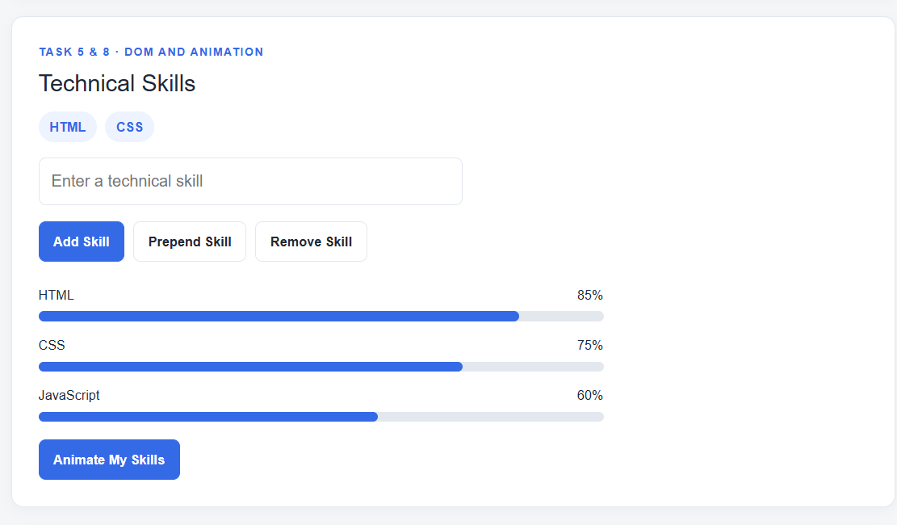

# Assignment #6 — jQuery (Selectors, Effects, Animations)

**Name:** Zhanbolat Tulepbergen  
**Group:** IT-2513

## Project
A simple personal portfolio demonstrating the required jQuery selectors, effects, DOM manipulation, form interaction, and animation.

## How to run
1. Download or clone this repository.
2. Open `index.html` in a browser.
3. Make sure you have an internet connection so the jQuery CDN can load.
4. Open browser Developer Tools → Console to see `jQuery is ready!`.

## Assignment Tasks

### Task 0. Setup
jQuery 3.7.1 is included from a CDN. The script runs inside `$(document).ready()` and prints `jQuery is ready!` in the browser console.

**Screenshot:**  

### Task 1. Selectors & CSS
The portfolio displays my name, headline, and introduction. Tag (`h1`), ID (`#main-heading`), and class (`.intro`) selectors are used. `.text()` updates the greeting and `.css()` changes styling. The Light Theme and Dark Theme buttons switch the page theme.

**Screenshot:**  

### Task 2. Visibility Methods
The About Me section includes a short biography, current status, and fun facts. Hide, Show, and Toggle buttons use `.hide()`, `.show()`, and `.toggle()`.

**Screenshot:**  

### Task 3. Fade Methods
The gallery contains two images. Fade In, Fade Out, and Fade Toggle buttons use `.fadeIn()`, `.fadeOut()`, and `.fadeToggle()`.

**Screenshot:**  

### Task 4. Slide Methods
Three clickable headings contain information about favorite music, movie, and subject. The panels use `.slideUp()` and `.slideDown()` to open and close smoothly.

**Screenshot:**  

### Task 5. Add & Remove Elements
The initial technical skills list contains HTML, CSS, JavaScript, and jQuery. The input and buttons use `.append()`, `.prepend()`, and `.remove()`. Empty input is ignored.

**Screenshot:**  

### Task 6. Modifying Attributes
The social link destination changes between GitHub and LinkedIn with `.attr()`.

**Screenshot:**  

### Task 7. Form Interaction
The form has Name and Email inputs. The entered values are read with `.val()` and displayed live with `.text()`.

**Screenshot:**  

### Task 8. Basic Animation
Three skill bars start with zero width. The Animate My Skills button uses `.animate()` to show different skill levels and, when clicked again, return the bars to zero width.

**Screenshot:**  

## Work Summary
I created a simple portfolio using HTML and CSS, then added jQuery functionality for selectors, theme switching, visibility effects, image fading, slide panels, list manipulation, attribute changes, live form preview, and skill bar animation. I tested the interactions in the browser.

## Files
- `index.html` — page structure and jQuery CDN
- `style.css` — simple responsive design
- `script.js` — all required jQuery functionality
- `images/` — local gallery illustrations
- `screenshots/` — screenshots for the assignment tasks
